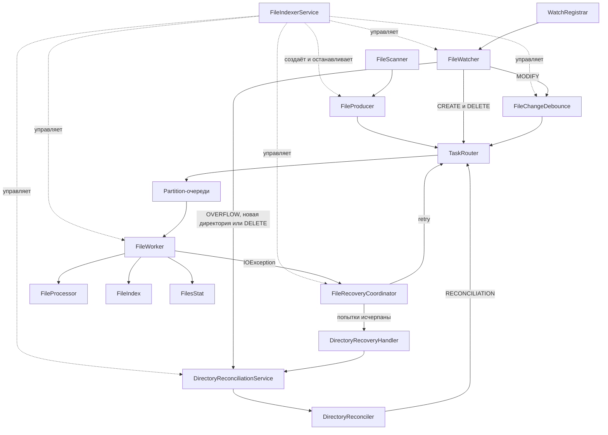

# File Indexer

📖 [Интерактивная карта проекта и памятка](docs/architecture.html) · [Как открыть](docs/README.md)

Учебный многопоточный индексатор Markdown-файлов на Java.

Программа рекурсивно сканирует выбранную директорию, сохраняет метаданные файлов
в памяти, следит за изменениями через `WatchService` и восстанавливает индекс
после временных ошибок или потерянных событий.

Проект развивается поэтапно: каждый механизм добавляется для решения конкретной
проблемы многопоточного приложения. Подробный учебный план находится в
[`PROGRESS.md`](PROGRESS.md).

Новое направление — учебная локальная система версий на базе индексатора.
Сначала планируются ручные коммиты, сохранение содержимого, status, построчный
diff и история. Затем — восстановление версий и автоматическое сохранение.
Эти возможности пока не реализованы. Первая версия сохраняет `.md`-файлы,
использует собственный формат и линейную историю без веток и удалённого обмена.

## Возможности

- рекурсивный поиск `.md`-файлов;
- первоначальное построение индекса;
- автоматическое отслеживание создания, изменения и удаления файлов;
- наблюдение за существующими и новыми вложенными директориями;
- параллельная обработка файлов несколькими Worker-потоками;
- сохранение порядка событий одного пути через partitioning очередей;
- debounce частых событий `MODIFY`;
- подсчёт количества файлов, общего размера и ошибок обработки;
- повторные попытки чтения файла с увеличивающейся задержкой;
- восстановление через повторное сканирование родительской директории;
- обработка `WatchService.OVERFLOW`;
- объединение повторных запросов сканирования одной директории;
- синхронизация запуска watcher и первоначального сканирования;
- отдельный `FileIndexerService` с состояниями lifecycle и согласованным shutdown;
- безопасные конкурентные вызовы `start()` и `shutdown()`;
- сохранение interruption-флага после полной очистки ресурсов;
- передача ошибок initial scan из producer в сервис с остановкой ресурсов;
- автоматическая остановка при runtime-ошибке Worker или службы reconciliation;
- продолжение очистки после ошибок отдельных этапов с сохранением причин;
- передача таймаутов завершения executors через termination future;
- абсолютные нормализованные пути для initial scan и watcher;
- согласованный immutable snapshot индекса и статистики под общей блокировкой;
- автоматические unit-, integration-, concurrency- и stress-тесты.

Сейчас индексируются только файлы с расширением `.md` в нижнем регистре.

## Архитектура



### Основные компоненты

| Компонент | Ответственность |
|---|---|
| `Main` | Читает путь, запускает `FileIndexerService` и выводит snapshot индекса со статистикой |
| `FileIndexerService` | Инкапсулирует сборку компонентов, запуск, состояния lifecycle и согласованный shutdown |
| `FileScanner` | Рекурсивно находит обычные `.md`-файлы |
| `FileProducer` | Превращает результаты первоначального обхода в `FileTask` |
| `FileWatcher` | Получает события от `WatchService` |
| `WatchRegistrar` | Регистрирует директории и хранит соответствие `WatchKey → Path` |
| `FileChangeDebounce` | Объединяет частые события `MODIFY` одного файла |
| `TaskRouter` | Выбирает очередь по хешу пути |
| `FileWorker` | Обрабатывает задачи и обновляет индекс со статистикой |
| `FileProcessor` | Читает размер и время изменения файла |
| `FileIndex` | Управляет `ConcurrentHashMap<Path, FileInfo>` |
| `FilesStat` | Хранит внутренние счётчики и обновляет их через смысловые операции |
| `FileRecoveryCoordinator` | Управляет ограниченными повторными попытками файла |
| `DirectoryRecoveryHandler` | После исчерпания retry запрашивает проверку родительской папки |
| `DirectoryReconciliationService` | Асинхронно запускает и объединяет повторные проверки директорий |
| `DirectoryReconciler` | Сверяет пути на диске с путями в индексе |

## Модель задачи

Каждая файловая задача содержит:

```text
FileTask
├── Path
├── ChangeType
└── TaskSource
```

`ChangeType` определяет операцию:

- `CREATED`;
- `MODIFIED`;
- `DELETED`.

`TaskSource` показывает происхождение задачи:

- `NORMAL` — первоначальный обход или событие watcher;
- `RECOVERY` — повторная попытка после ошибки;
- `RECONCILIATION` — задача из полной сверки директории.

## Первоначальный запуск

Приложение запускает компоненты в следующем порядке:

```text
Запуск Worker
→ запуск FileWatcher
→ ожидание регистрации существующих директорий
→ первоначальное сканирование
→ обработка файлов
```

Watcher запускается до первоначального обхода, поэтому изменения во время
сканирования не остаются полностью без наблюдения.

`FileProducer` сообщает результат через `CompletableFuture<Void>`: успех,
`IOException`, причину `UncheckedIOException`, `RuntimeException` или прерывание.
`runInitialScan()` через `anyOf()` ожидает завершения Producer или общего
`workerFailure`. Ошибка передаётся в `start()`, который сохраняет причину и
выполняет `shutdown()`, в том числе прерывает Producer, заблокированный в `put()`.

После успешного initial scan один общий `BarrierTask` отправляется в каждую
partition-очередь. Он хранит `AtomicInteger` и future: каждый Worker вызывает
`arrive()`, последний завершает future. `Main` печатает первоначальный индекс
после обработки предшествующих барьерам задач. Будущие retry барьер не ожидает.

Барьер отправляется мгновенным `offer()` под `lifecycleLock` вместе с проверкой
`STARTING`. Если очередь полна, сервис отпускает lock, делает паузу 50 мс и
повторяет попытку, проверяя `workerFailure`. Затем `anyOf()` ожидает готовности
барьера или ошибки Worker. Shutdown может отменить отправку барьеров.

Корень преобразуется в абсолютный нормализованный путь в конструкторе сервиса
и передаётся в таком виде watcher и producer.

### Согласованность snapshot

Все Worker одного сервиса используют общий `indexStateLock`. Добавление,
обновление или удаление записи и соответствующее изменение статистики
выполняются под этой блокировкой. `snapshot()` копирует Map и читает счётчики
под той же блокировкой. Чтение файлов и вызовы recovery остаются вне неё.
Снимок согласован с индексом, но не является атомарным снимком самого диска.

## Lifecycle и shutdown

`FileIndexerService` использует явные состояния:

```text
NEW → STARTING → RUNNING → STOPPING → STOPPED
```

Проверка состояния и запуск каждого источника задач защищены общим
`lifecycleLock`. Поэтому конкурентный `shutdown()` либо отменяет ещё не
начавшийся шаг запуска, либо корректно останавливает уже запущенный компонент.

Порядок завершения:

```text
Остановить watcher и initial producer
→ запретить новые debounce, recovery и reconciliation-запросы
→ завершить или отменить executor-задачи
→ отправить StopTask каждому живому Worker
→ дождаться всех Worker
→ установить STOPPED и разбудить ожидающие shutdown-потоки
```

Повторный `shutdown()` во время `STOPPING` ждёт полного завершения первого.
Прерывание не обрывает очистку: оно запоминается, а interruption-флаг
восстанавливается после освобождения ресурсов.

`stopWorkers()` сопоставляет потоки с очередями по индексу. Завершившиеся потоки
пропускаются; живым `StopTask` отправляется через `offer()` с таймаутом 2 секунды
и повторной проверкой `isAlive()`. Затем сервис выполняет `join()`.
При аварии необработанные задачи завершившегося Worker не считаются выполненными.

Сервис реализует `AutoCloseable`; `Main` использует явный `finally` с `shutdown()`.
Supervisor после перехода в `RUNNING` через `CompletableFuture.anyOf()` ждёт
завершения watcher, ошибки Worker или аварии службы reconciliation. Любой из
этих сигналов запускает остановку сервиса. Внешний перехват в Worker охватывает
весь цикл, включая ошибки внутри обработчиков `IOException`.

Каждый этап очистки отдельно перехватывает `RuntimeException`, поэтому ошибка
одного этапа не пропускает следующие. `recordTerminationFailure()` сохраняет
первую причину, а последующие прикрепляет через `addSuppressed()`; один объект
исключения не прикрепляется к самому себе. Повторный shutdown не повторяет очистку.

Executors debounce и rescan получают до 30 секунд на штатное завершение и ещё
до 30 секунд после `shutdownNow()`. Recovery executor ожидается до одной секунды
после `shutdownNow()`. Исчерпание ожиданий вызывает `IllegalStateException`:
очистка продолжается, но результат остановки считается ошибочным. Прерывания
ожидания запоминаются; ожидание повторяется с тем же таймаутом.

Публичный `getTermination()` возвращает копию future результата остановки;
ошибка передаётся через exceptional completion. При ошибочном завершении статус
`STOPPED` означает, что процедура очистки закончилась, но не доказывает, что
executor, проигнорировавший прерывание, фактически остановился.

## Обработка событий

### Создание и изменение

`CREATED` и `MODIFIED` обрабатываются как upsert:

- если записи нет, файл добавляется;
- если запись существует, метаданные заменяются;
- общий размер корректируется на разницу между новым и старым значением.

Поэтому повторный `CREATE` и `MODIFY` неизвестного индексу файла не создают
дубликатов.

Если новая вложенная папка исчезла во время рекурсивной регистрации, watcher
локально обрабатывает `NoSuchFileException`, запрашивает сверку родительской
директории и продолжает наблюдение. Исчезнувшая папка не получает собственный
rescan и не отправляется как файловый `CREATE`, даже если её имя оканчивается
на `.md`. Другие ошибки регистрации сохраняют прежнюю обработку.

### Удаление

При `DELETED` запись удаляется из индекса. Повторное удаление безопасно и не
делает статистику отрицательной.

Если файл исчез между событием и чтением метаданных, `NoSuchFileException`
также обрабатывается как удаление.

### Частые изменения

Для `MODIFY` применяется debounce на 500 мс. Новое событие отменяет предыдущую
ожидающую задачу. При удалении файла отложенный `MODIFY` отменяется.

Замена ожидающей задачи выполняется атомарно для конкретного пути. Каждая
запланированная задача получает собственный номер, поэтому завершившийся старый
callback не может удалить из `Map` более новую задачу.

## Порядок и параллельность

`TaskRouter` вычисляет очередь по хешу `Path`. Один путь всегда направляется в
одну очередь и обрабатывается одним Worker:

```text
a.md → Queue-1 → Worker-1
a.md → Queue-1 → Worker-1
b.md → Queue-3 → Worker-3
```

Это сохраняет последовательность событий одного файла. Разные пути могут
обрабатываться параллельно, хотя несколько путей способны попасть в одну
partition-очередь.

## Восстановление после ошибок

При `IOException` запускается одна recovery-цепочка для проблемного пути.
Используются три повторные попытки:

```text
retry 1 → 500 мс
retry 2 → 1000 мс
retry 3 → 2000 мс
```

Успешная обработка удаляет цепочку и отменяет ожидающую попытку. Если все retry
завершились ошибкой, запускается reconciliation родительской директории.

Во время reconciliation объединяются:

- `.md`-файлы, существующие на диске;
- пути этой директории, сохранённые в индексе.

Все объединённые пути повторно проходят через Worker. Благодаря этому индекс
добавляет пропущенные файлы, обновляет существующие и удаляет исчезнувшие.

Если файл остаётся недоступным и после reconciliation, новая бесконечная цепочка
не создаётся: файл считается проблемным до следующего обычного события или
повторной проверки.

Несколько запросов reconciliation одной директории объединяются. Запрос,
пришедший во время текущего обхода, создаёт только один дополнительный проход.

При неожиданной `RuntimeException` статус директории удаляется, повторный
проход текущей задачи отменяется, а future службы завершается с исходной ошибкой.
Supervisor замечает её и останавливает сервис. Успешная отдельная сверка этот
future не завершает; обработанные `IOException` и `UncheckedIOException`
сохраняют возможность следующего запроса.

## Технологии

- Java 25;
- Java NIO: `Path`, `Files`, `WatchService`;
- `Thread` и interruption;
- `BlockingQueue` и `ArrayBlockingQueue`;
- `ConcurrentHashMap`;
- `AtomicInteger` и `LongAdder`;
- `ExecutorService`;
- `ScheduledExecutorService` и `ScheduledFuture`;
- Stream API;
- Maven;
- JUnit 5.

## Запуск

Требования:

- JDK 25;
- Maven 3.9+ либо запуск из IntelliJ IDEA.

Сборка и тесты:

```bash
mvn test
```

Запуск из IntelliJ IDEA:

1. Открыть проект как Maven-проект.
2. Выбрать класс `org.example.Main`.
3. Запустить метод `main()`.
4. Ввести абсолютный путь к директории.

После первоначального сканирования программа печатает индекс и статистику.
Затем она продолжает следить за изменениями до нажатия `ENTER` или завершения
watcher. Один daemon-поток читает консоль и отправляет события в общую очередь.
После остановки сессии приложение запрашивает новый путь; EOF завершает приложение.
Удаление корня приводит к `RootWatchLostException` и автоматической остановке
сервиса. События завершения сессий различаются по `runId`.

## Тестирование

Тестовый набор содержит 138 обычных сценариев и 25 повторных lifecycle-запусков:
163 JUnit-выполнения в 25 классах. Это сценарное покрытие, а не процент покрытия
строк кода.

| Подсистема | Что проверяется | Тестов | Статус |
|---|---|---:|:---:|
| Модель задач | Проверки параметров, независимые барьеры, конкурентный arrive, защита future | 9 | ✅ |
| Индекс и Worker | Immutable snapshot, upsert/DELETE, замена файла папкой, barrier, runtime-ошибка обработчика recovery | 14 | ✅ |
| Статистика | Добавление, удаление, изменение размера, ошибки и конкурентные обновления | 5 | ✅ |
| Watcher | Создание `.md`, вложенные директории, перенос и удаление дерева, фильтрация папки `.md`, `OVERFLOW`, исчезновение папки при регистрации | 12 | ✅ |
| Debounce | 2000 быстрых и конкурентные `MODIFY`, порядок событий, отмена и shutdown | 9 | ✅ |
| Recovery | Retry, задержки, независимые цепочки, успех, исчерпание попыток, проблемный файл | 17 | ✅ |
| Reconciliation | Сверка, объединение запросов, IOException и interruption, runtime-авария, очистка статуса и защита future | 14 | ✅ |
| Интеграция и нагрузка | Сходимость индекса, 200 файлов и 800 событий, изменения во время initial scan | 3 | ✅ |
| Lifecycle и пути сервиса | Start/shutdown, потеря корня, ошибки запуска и после RUNNING, barrier, snapshot, suppressed-ошибки очистки и таймауты executors | 61 | ✅ |
| Producer | Future успеха/ошибок, interruption-флаг, исходная причина, защита future | 6 | ✅ |
| Processor | Метаданные, отсутствующий путь и обычный тип файла | 3 | ✅ |
| Регистрация watcher | Ошибки обычного и ленивого обхода, runtime-сбой startup, cleanup | 3 | ✅ |
| Консольный Main | Отдельный JVM-процесс: EOF, ввод пути, несколько сессий и потеря корня | 7 | ✅ |
| **Всего** | **Unit-, integration-, concurrency- и stress-сценарии** | **163** | **✅** |

### Карта тестовых классов

```text
163 выполнения тестов
├── задачи: FileTaskTest, BarrierTaskTest
├── индекс: FileIndexTest, FileWorkerTest
├── статистика: FilesStatTest
├── watcher: FileWatcherTest, FileWatcherOverflowTest, FileWatcherModifyTest,
│            FileWatcherRegistrationRaceTest
├── producer: FileProducerTest
├── processor: FileProcessorTest
├── регистрация: WatchRegistrationFailureTest
├── консоль: MainProcessTest
├── debounce: FileChangeDebounceTest
├── recovery: FileRecoveryCoordinatorTest, DirectoryRecoveryHandlerTest
├── reconciliation: DirectoryReconcilerTest,
│                   DirectoryReconciliationServiceTest
├── lifecycle: FileIndexerServiceLifecycleTest,
│             FileIndexerServiceCleanupFailureTest,
│             FileIndexerServiceExecutorShutdownTest,
│             FileIndexerServiceSnapshotTest, FileIndexerServicePathTest
└── интеграция: IndexResilienceIntegrationTest,
                InitialScanConcurrencyTest
```

Отдельно проверено, что старая уже выполняющаяся debounce-задача не удаляет
ссылку на более новую ожидающую задачу. Этот тест воспроизводит реальную гонку,
а не только последовательный вызов методов.

Последний подтверждённый полный прогон (2026-11-02):

```text
Tests run: 163, Failures: 0, Errors: 0, Skipped: 0
BUILD SUCCESS
```

Ранее найденное расхождение после переноса заполненной директории наружу
исправлено через reconciliation родителя при `DELETE`; добавлены regression-тесты
переноса и удаления дерева. Исторические результаты аудита находятся в
[`INDEXER_REVIEW.md`](docs/INDEXER_REVIEW.md); актуальные статусы работ — в
[`PROGRESS.md`](PROGRESS.md).

Физическое переполнение системного буфера WatchService и изменение реальных ACL
Windows не создаются в тестах, поскольку такие проверки нестабильны. Вместо
этого детерминированно проверяется реакция приложения на `OVERFLOW` и
`AccessDeniedException`.

Исчезновение папки при регистрации воспроизводится через тестовый
`DirectoryWalker`, включая ленивую ошибку обхода. Таймауты executors проверяются
управляемыми тестовыми реализациями без минутных ожиданий и зависших потоков.

## Текущие ограничения

- вывод ошибок пока основан на `System.err` и `printStackTrace()`;
- shutdown не имеет общего предельного времени ожидания Worker; таймаут executor
  передаётся как ошибка, но не может принудительно завершить игнорирующую
  прерывание задачу;
- supervisor запускается после initial scan и barrier; отдельная проверка ранней
  аварии reconciliation во время `STARTING` пока не добавлена;
- политика symbolic links и молчаливого пропуска недоступных путей scanner ещё
  не определена; пользовательский поиск исключён из ближайшего плана;
- физический `OVERFLOW` и изменение реальных Windows ACL заменены
  детерминированными тестовыми сценариями.

## Следующие шаги

Инкапсуляция завершена: `FileIndex` самостоятельно создаёт Map и возвращает
неизменяемые копии, а `FilesStat` скрывает атомики и принимает операции
`fileAdded`, `fileSizeChanged`, `fileRemoved` и `recordError`.

Новый план согласован в `PROGRESS.md`: устройство репозитория → хранение
содержимого → ручные коммиты → status → построчный diff → команды и история →
восстановление → автоматическая история. Завершены обработка падения Worker
после `RUNNING`, аварий reconciliation, исчезновения вложенной папки при
регистрации, ошибок отдельных этапов cleanup и таймаутов executors.
До этапа 14 нужно определить политику symbolic links и недоступных файлов,
проверить оставшиеся ограничения и завершить документацию основы индексатора.

Watcher будет помогать обнаруживать изменения, а сохранение коммита должно
проверять фактическое содержимое диска. Пользовательский поиск исключён из
ближайшего плана. Открытые задачи надёжности и технического долга сохранены.
